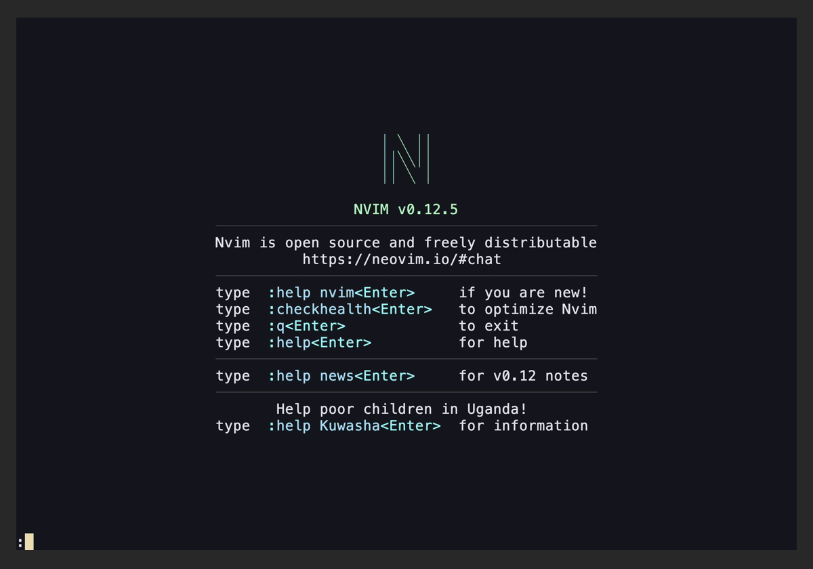

# vimdojo

Learn Vim motions by solving tiny puzzles, right inside Neovim.



Each level gives you a snippet of text and a goal ("delete the typo", "put the
cursor on the last word"). Solve it with Vim keys. You're scored on keystrokes,
time and the level's par. Every key counts, so finding the short way is the
game.

**[Try the browser demo](https://vimdojo.org)**, then
install the plugin for the real thing.

- 84 levels in sixteen packs across three tracks. **Motions** covers basic
  motions through macros and Ex commands. **Usage** covers windows and
  buffers, project-wide edits with the quickfix list, and Neovim's built-in
  defaults. **Setup** teaches writing (and fixing) an `init.lua`: options,
  keymaps, autocommands and user commands, checked by running your config in
  a sandboxed Neovim.
- A live timer and key counter, with stars and points against par
- Hints, instant reset, and progress saved across sessions
- Every level runs in a clean, isolated Neovim (or with your own config, if
  you prefer)
- No dependencies, and near-zero startup cost (only the command is defined
  until you use it)

## Install

Requires Neovim 0.10+.

**lazy.nvim**

```lua
{ "navasvarela/vimdojo", cmd = "VimDojo", opts = {} }
```

**packer.nvim**

```lua
use({ "navasvarela/vimdojo" })
```

**vim-plug**

```vim
Plug 'navasvarela/vimdojo'
```

**rocks.nvim**

```vim
:Rocks install vimdojo
```

Then run `:VimDojo`. Full documentation: `:help vimdojo`.

## Playing

| Key / command | Action |
|---|---|
| `:VimDojo` | Open the level menu (`<CR>` to play, `q` to close) |
| `:VimDojo daily` | Play today's daily challenge, the same level for everyone and on the site |
| `<leader>h` | Show the hint (caps the attempt at 2 stars) |
| `<leader>r` | Restart the level |
| `<Esc><Esc>` | Leave the level |
| `n` / `r` / `y` / `m` | On the results card: next level, retry, copy a spoiler-free result to share, menu |

The timer starts on your first key. Every physical key counts (`d2w` is 3
keys, `<Esc>` is 1), and the game's own control keys never do. A level is
solved as soon as its goal holds in Normal mode.

**Stars:** 3 for matching par on both keys and time, 2 for up to 1.5× par
keys, and 1 for solving it. Par is the shortest solution that uses only the
motions taught so far, so if you know more Vim, you can beat it.

## Configuration

```lua
require("vimdojo").setup({
  unlock_all = false,  -- skip progression locks
  window = "float",    -- "float" | "tab"
  config = "clean",    -- "clean": levels run in a stock Neovim; "mine": with your config
  progress_path = nil, -- defaults to stdpath("data")/vimdojo/progress.json
  challenges_dir = nil, -- play your own packs instead of the built-in ones
  keymaps = { hint = "<leader>h", reset = "<leader>r", quit = "<Esc><Esc>" },
})
```

Each level runs in its own clean Neovim inside a terminal window, so your
registers, windows and settings are never touched, and your plugins can't
interfere with par. Set `config = "mine"` to practice with your own setup.

## Contributing

New levels are the best contribution: they're plain JSON, and the tests prove
each one is solvable within par in real Neovim. See
[docs/authoring-levels.md](docs/authoring-levels.md) and
[CONTRIBUTING.md](CONTRIBUTING.md). Design decisions are logged in
[docs/decisions.md](docs/decisions.md).

## License

[MIT](LICENSE)
